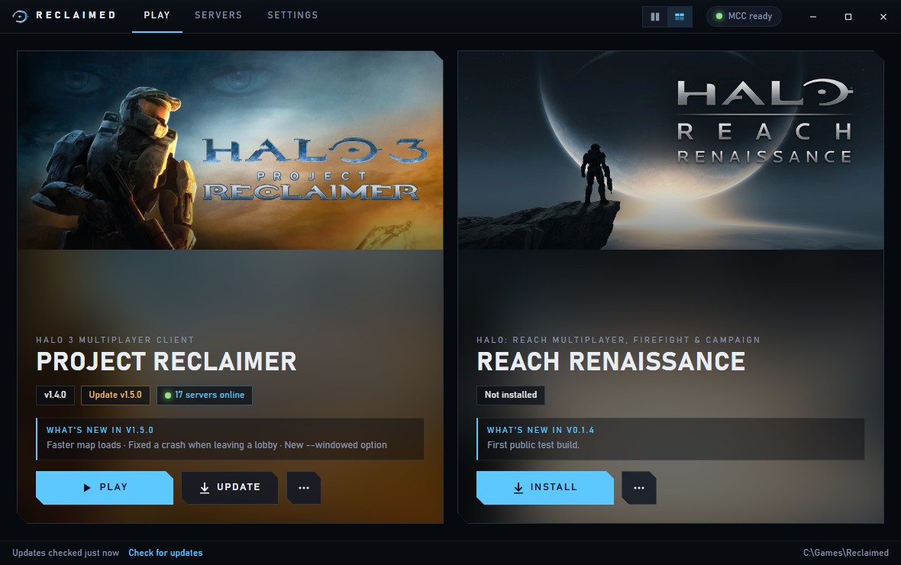
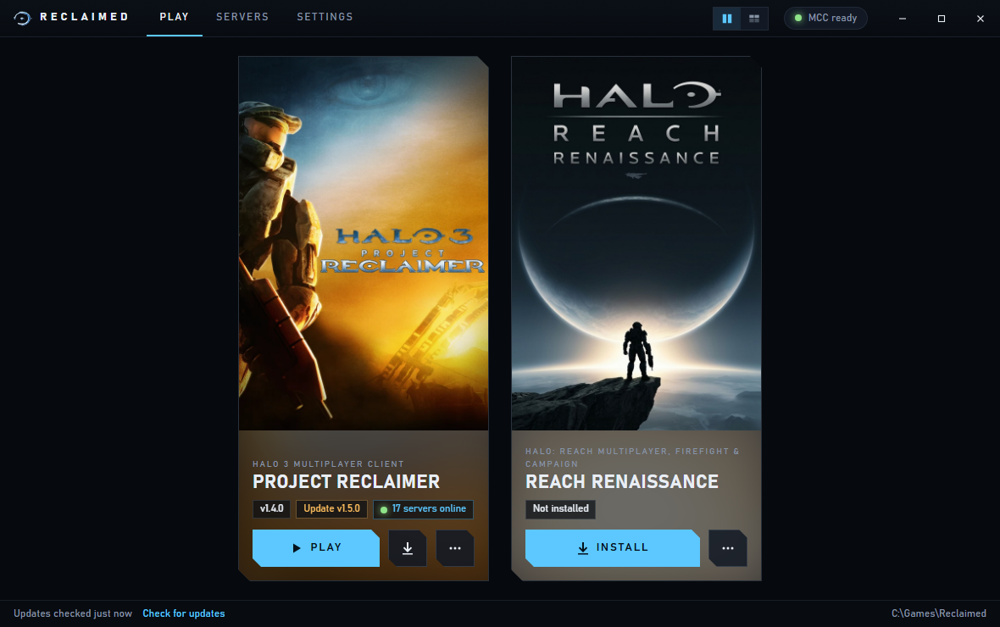
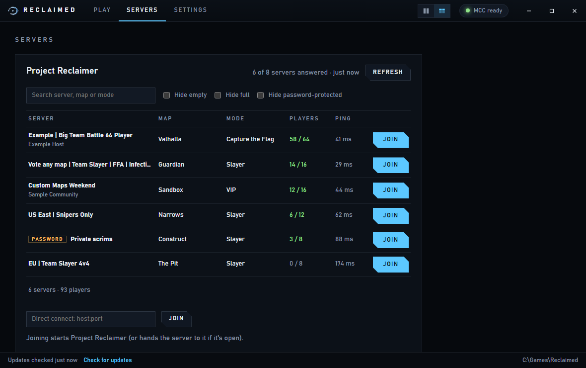
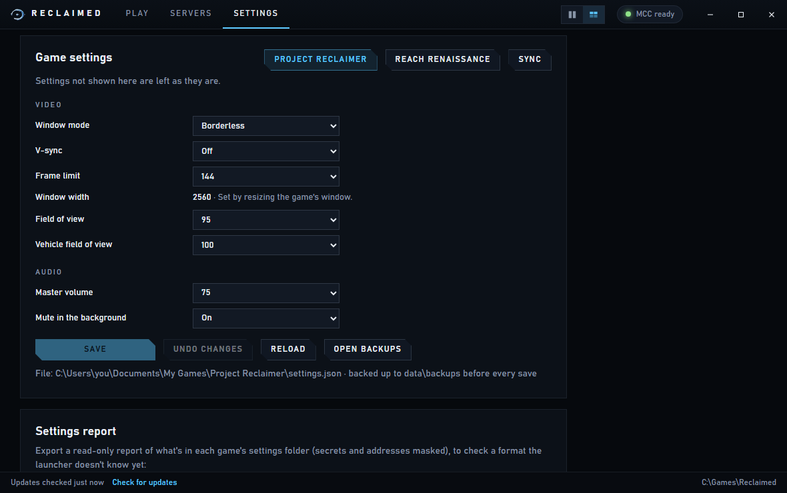
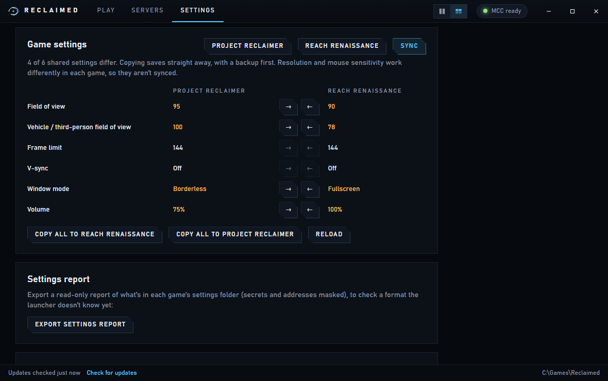

# Reclaimed

**A Windows launcher for [Project Reclaimer](https://github.com/ProjectReclaimer/project-reclaimer-releases) (Halo 3) and [Reach Renaissance](https://github.com/NETF1ix/reach-renaissance-releases) (Halo: Reach).**

Both are fan-made clients that run on Steam's *Halo: The Master Chief
Collection*. Reclaimed installs them from their official GitHub releases,
checks every download, keeps them up to date and starts them. It also has a
server browser for Project Reclaimer and one settings page for both games.



> Unofficial. Not affiliated with Microsoft, Halo Studios, 343 Industries,
> Bungie, or either game's developers. The built-in cover images are fan-made
> and include Halo trademarks and artwork, which belong to Microsoft.

## Download

**Easiest:** go to **https://tman-comps.github.io/Reclaimed-Launcher/**. It has
one Download button and step-by-step install help.

Or by hand:

1. Get `Reclaimed.exe` from the [latest release](https://github.com/tman-comps/Reclaimed-Launcher/releases/latest).
2. Put it in a folder of its own, for example `C:\Games\Reclaimed\`. Don't use
   Program Files or MCC's folder.
3. Run it. It isn't code-signed, so Windows SmartScreen warns the first time:
   choose **More info > Run anyway**.

Each release also has a `SHA256SUMS.txt`. To check your download:

```powershell
Get-FileHash .\Reclaimed.exe -Algorithm SHA256
```

**You need:** Windows 10 or 11 (64-bit) and *Halo: The Master Chief Collection*
on Steam, with Halo 3 installed for Project Reclaimer and Halo: Reach installed
for Reach Renaissance. Nothing else gets installed: Reclaimed is one exe.

## What it does

### Install, update and play

- **Finds MCC.** It reads your Steam libraries and checks that Halo 3 and Halo:
  Reach are installed. If MCC lives somewhere unusual, choose its folder under Settings.
- **Installs both games** from their own GitHub releases. A download is used only
  if it matches the release's `SHA256SUMS.txt`.
- **Shows versions and updates.** It checks for new releases at startup and
  shows each one's notes. It never updates on its own: you press **Update**.
- **Respects the games' own updaters.** Both games can update themselves.
  Reclaimed recognises those updates and never writes to a game's folder while
  anything runs from it.
- **Keeps a rollback.** The version before your last update is kept in `games\.previous\`.
- **Already have a game installed?** Use **... > Use an existing install** and
  Reclaimed will only launch it.
- Two layouts, **Banners** and **Cards**, switched in the title bar.
- **Desktop shortcut and Add to Steam.** One click each, from the tip on the
  Play page or Settings › Launcher. Add to Steam puts Reclaimed in your Steam
  library, so you can start it from Steam (or Big Picture).
- **Updates itself.** When a new Reclaimed is released, a banner offers
  **Update now**. It downloads the new exe, checks it against the release's
  `SHA256SUMS.txt`, swaps it in and restarts. Your games and settings stay.



### Server browser (Project Reclaimer)

Lists every public Project Reclaimer server with its name, map, mode, players
and ping. Search, hide empty, full or password-protected servers, click a row
for details, and press **Join**. Joining hands the server to the game through
its own `reclaimer://join/` link. If the game is already open, it switches to
that server. There's also Direct Connect for a `host:port`.



Reach Renaissance's games aren't listed. It has no supported way for another
program to join a game, so use its own in-game browser.

### Game settings

Settings > Game settings edits each game's video, graphics and audio settings
without starting the game: window mode, frame limit, v-sync, field of view
(70 to 120) and vehicle field of view, graphics quality, and volume.

- Before every save, the game's settings file is backed up to
  `data\backups\<game>\`. The last 20 are kept, and **Open backups** shows them.
- Settings the page doesn't show are kept exactly as they are.
- Saving is refused while the game runs, or if the file changed since it was loaded.

**Borderless fullscreen by default.** Both games start in a window unless
you change it. The first time Reclaimed starts each game, it switches that
game to borderless fullscreen, but only if it's still on the game's default
(windowed); a mode you picked yourself is kept. It does this once per game,
with a backup like any save. For Project Reclaimer that happens once the game
has written its settings file (after you first change a setting in its menu),
because Reclaimed never creates that file itself. Change it any time under
Game settings or in the game.



**Sync** compares the six settings both games share (field of view, vehicle
field of view, frame limit, v-sync, window mode and volume). You can copy any
of them, or all at once, in either direction. Nothing syncs unless you click.



## What it touches

Reclaimed writes only inside its own folder:

```
Reclaimed\
  Reclaimed.exe
  games\
    reclaimer\             project-reclaimer-client-v<ver>.exe
    reach-renaissance\     unzipped release (Reach Renaissance.exe ...)
    .staging\              downloads in progress (cleaned up)
    .previous\<game>\      the version before the last update, for rollback
  data\
    state.json             what was installed, version and exe SHA-256
    launcher.log
    backups\<game>\        settings files from before each save
    webview\               WebView2 cache (kept here, not in %APPDATA%)
  reports\                 settings reports (read-only scans)
  art\                     optional cover overrides (see below)
```

There's one exception. When you press **Save** or copy a setting under Game
settings, or the first time it starts a game (to set borderless fullscreen,
above), Reclaimed writes that game's own settings file (`settings.json` in
`Documents\My Games\Project Reclaimer`, or `settings.txt` in
`%LOCALAPPDATA%\ReachRenaissance`).

Two buttons write elsewhere, and only when you press them:

- **Create desktop shortcut** puts `Reclaimed.lnk` on your desktop.
- **Add to Steam** adds Reclaimed to your Steam library as a non-Steam game.
  It writes Steam's list of non-Steam games
  (`Steam\userdata\<your id>\config\shortcuts.vdf`), after copying the old
  one to `data\backups\steam\`. Steam has to be closed while it does this,
  so if Steam is open, Reclaimed asks before closing it and then reopens it.

It never modifies the games' exes or MCC's files. It reads the Steam
registry keys and library files, MCC's folder and the two games' settings folders.

**On the network**, it talks to:

- GitHub, for releases;
- Project Reclaimer's discovery servers, for the server list;
- each listed Reclaimer server, when it starts, every 5 minutes (for the
  player count on the Halo 3 card) and when the Servers page is opened or
  refreshed. It asks only for public status (name, map, players). It never
  sends your name or identity;
- Reach Renaissance's master server, once a minute, for the server and
  player count on the Reach card (read-only).

If WebView2 is missing (rare on Windows 10/11), the built-in installer offers
to add it. That's the only thing ever installed outside the launcher's folder.

## Cover art

Default covers for both games are built in. To use your own, put an image with
one of these names in `art\` next to the exe. Delete it to go back to the
built-in cover.

| File | Size | Used by |
|---|---|---|
| `reclaimer-tall.<png/jpg/webp>` | 600×900 | Cards layout |
| `reclaimer-wide.<...>` | 920×430 | Banners layout |
| `reach-renaissance-tall.<...>` | 600×900 | Cards layout |
| `reach-renaissance-wide.<...>` | 920×430 | Banners layout |

## FAQ

**Windows says "Windows protected your PC".** The exe isn't code-signed. Choose
**More info > Run anyway**, or check its hash against `SHA256SUMS.txt` first.

**A game updated itself, and now the launcher says "Updated in-game".** That's
expected. Reclaimed noticed the new version and leaves updating to the game.

**Where's the log?** `data\launcher.log` next to the exe.

**Can I move the folder?** Yes. Move the whole `Reclaimed\` folder together.

**Something's wrong.** Please [open an issue](https://github.com/tman-comps/Reclaimed-Launcher/issues).
Include `data\launcher.log`, and for settings problems the report from
**Settings > Export settings report** (secrets and addresses are masked).

---

## For developers

### Stack: Go + Wails v2

| Need | Why Wails |
|---|---|
| One exe, no installer | Go builds a static binary and Wails embeds the UI: `Reclaimed.exe` is about 15 MB. |
| Polished UI | The UI is HTML/CSS rendered by WebView2 (the Edge engine already on Windows 10/11). |
| Windows system access | `golang.org/x/sys/windows` gives the registry, process list, known folders and exe version info, all without cgo. |
| Safe file handling | Go's standard library covers SHA-256, zip extraction (with zip-slip checks), HTTP and atomic renames. |

Electron (150 MB or more), Tauri (cross-compiling Rust for MSVC is harder) and
.NET WPF (a 70 MB exe or a runtime install) were also considered.

### How updates avoid fighting the games' own updaters

1. **Versions are identified by content, not by filename.** The main exe's SHA-256 is
   recorded at install. If the exe changes and matches the latest release's
   SHA256SUMS entry (Reclaimer), the new version is accepted. If it changes to
   something it can't map (Reach, whose sums cover only the zip), it shows
   "Updated in-game" and stops suggesting updates.
2. **Updates are checked only at startup**, and never installed automatically.
3. **Nothing is written while anything runs from the game's folder**, including the
   game's updater. This is checked before the download and again before swapping.
4. **Files are swapped atomically.** Downloads go to `games\.staging` and must
   match SHA256SUMS (and GitHub's asset digest when present). Only then is
   the live copy moved to `.previous` and the new one moved in. If that fails,
   the old copy is restored.

### Building

Requires Go 1.26+ and the Wails CLI:

```bash
go install github.com/wailsapp/wails/v2/cmd/wails@v2.10.1
```

The frontend is static files in `frontend/dist`, so there's no npm step.

Wails v2.10.1 can't load packages with Go 1.27 or newer (`internal error:
package "context" without types ...`). If your Go is newer, build with the 1.26
toolchain, which Go downloads automatically:

```powershell
$env:GOTOOLCHAIN = 'go1.26.10'
```

```bash
wails build -platform windows/amd64 -skipbindings -trimpath -ldflags "-s -w" -webview2 embed
```

Output: `build/bin/Reclaimed.exe`.

Tests (run on any OS; the Windows-only parts have stubs):

```bash
go test ./internal/...
```

A live check against the real Reclaimer servers, which needs the internet:

```powershell
$env:RECLAIMED_LIVE = 1; go test -run Live -v ./internal/servers/
```

`frontend/dev/mock.js` is a fake backend for previewing the UI in a normal
browser. `frontend/dev/preview.js` uses it to take screenshots with Playwright
(`node frontend/dev/preview.js <dir>`). Neither is shipped.

### Docs

- [docs/server-browser.md](docs/server-browser.md): how the server lists, status queries and joining work for both games.
- [docs/settings-formats.md](docs/settings-formats.md): both games' settings files, the options the page offers, and the Sync mapping.

### Code map

| Path | What |
|---|---|
| `main.go`, `app.go` | Wails window and the methods the UI calls |
| `internal/steam`, `internal/vdf` | Steam library and MCC detection |
| `internal/release` | GitHub latest release, SHA256SUMS, version compare |
| `internal/install` | Verified download, safe unzip, atomic swap |
| `internal/games` | Game definitions, status and version detection, install/launch/join |
| `internal/proc` | Running-process check, launch, exe version info |
| `internal/discovery` | Project Reclaimer's discovery servers (server addresses and count) |
| `internal/servers` | Server browser: asks each Reclaimer server for its status over QUIC; join links |
| `internal/settings` | Each game's settings file: read, validate, back up, write; Sync |
| `internal/report` | Read-only settings-folder scan |
| `internal/art` | Built-in cover images and `art\` overrides |
| `internal/state`, `internal/paths` | Saved launcher state; the launcher's folder layout |
